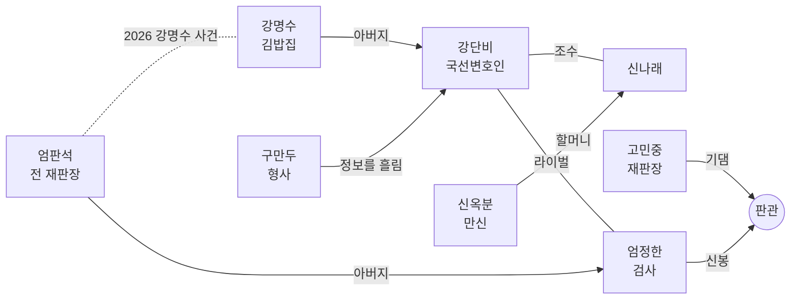

# 「판 뒤집기」 시리즈 설계

시리즈 1기(1~4화)의 세계관, 인물, 에피소드 줄기를 정리한 문서다. 새 사건을 쓰거나 기존 대사를 고칠 때 이 문서와 어긋나지 않게 한다. 바꿔야 할 설정이 생기면 이 문서를 먼저 고친다.

- 그림 규칙은 [art-guide.md](art-guide.md), 실행·대본 문법은 [README](../README.md)를 본다.
- 1화와 4화는 플레이할 수 있다. 2~3화는 이 문서의 줄기만 있다.

---

## 1. 한 줄 소개

> AI가 유죄 확률을 계산해 주는 2031년 서울. 사흘 안에 끝나는 재판에서, 신참 국선변호인 강단비가 숫자에 맞서 사람의 말로 판을 뒤집는다.

**시리즈의 질문:** 기계가 판단하는 세상에서, 사람의 말은 무엇을 뒤집을 수 있는가.

**제목:** 「판 뒤집기」. 재판(判)의 '판'과 판을 뒤집는다는 '역전'을 겹친 말이다. 씨름의 기술 이름이기도 하다.

---

## 2. 세계관

### 2.1 2031년 서울

AI가 일상의 많은 결정을 대신하는 근미래다. 기술 수준은 "지금 뉴스에 나오는 것들이 흔해진 정도"로 잡는다. 하늘을 나는 차나 로봇 경찰은 없다.

| 흔해진 것 | 예시 |
|---|---|
| 무인 매장 | 편의점·카페 대부분이 무인. 밤에는 진열·청소하는 관리원 한 명만 있다 |
| AI 상담원 | 콜센터의 대부분이 AI로 바뀌는 중 (4화) |
| AI 감정·평가 | 집값 자동 감정 앱, AI 신용 평가 (2화) |
| 생성형 AI | AI 강사, 목소리 복제, 딥페이크 (3화) |
| 스마트 기기 | 스마트 글라스(엄정한), 홀로그램 패널이 박힌 법정 벽 |

사람들의 정서는 두 갈래다. 일자리를 잃을지 모른다는 **불안**, 귀찮고 힘든 일을 덜어 줄 거라는 **기대**. 시리즈는 어느 한쪽 편을 들지 않는다. 기계 자체보다 **기계를 핑계 삼거나 기계 뒤에 숨는 사람**이 문제라는 쪽으로 이야기를 맺는다.

### 2.2 판관(判官): AI 판결 예측 시스템

법원행정처가 도입한 AI. 증거와 기록, 과거 판례를 학습해 사건마다 **유죄 확률**을 계산한다.

- 법정 화면에 예측률이 실시간으로 뜬다. 게임의 **체력 게이지**가 바로 이것이다.
- 법적으로는 "참고 자료"일 뿐이지만, 판사들은 점점 이 숫자에 기댄다. 100%에 가까우면 사실상 유죄가 선고된다.
- 판관은 **기록**을 사람의 **말**보다 무겁게 친다. 사원증 기록, 카메라 판정, 소득 데이터 같은 것들. 그래서 증언대에 선 사람이 가족이거나 가난하면 예측률이 오른다. 시리즈가 조금씩 드러내는 판관의 편향이다.
- 게임 안 표기는 "AI 판결 예측"이다. 인물들이 부를 때는 "판관"이라고 한다.

### 2.3 즉결공판제

재판 적체를 해결하려고 2028년에 시행된 제도. **모든 형사재판을 사흘 안에 끝낸다.** 판관이 증거 분석을 대신해 준다는 이유로 가능해졌다.

- 1일째 모두진술·증거조사, 2일째 증인신문, 3일째 판결이 기본 흐름이다. 실제로는 중간에 결정적인 증언이 나오면 일정이 당겨진다.
- 변호인이 조사할 수 있는 시간은 재판 전날과 재판 사이의 밤뿐이다. 게임의 "조사 파트"가 짧고 긴박한 이유다.
- 국선변호인 한 명이 너무 많은 사건을 맡는다. 강단비가 늘 시간에 쫓기는 배경이다.

### 2.4 연표

| 연도 | 일 |
|---|---|
| 2025 | 판관 시범 도입. 예측률은 판사만 참고용으로 본다 |
| 2026 | **강명수 사건.** 판관 예측 91%. 국선변호인의 권유로 강명수가 유죄를 인정한다 |
| 2027 | 블랙박스 영상이 나와 강명수가 재심에서 무죄. 당시 재판장 엄판석이 사퇴한다 |
| 2028 | 즉결공판제 시행. 판관 예측률을 법정 화면에 띄우는 것이 의무가 된다 |
| 2030 | 강단비, 변호사시험 합격 후 국선전담변호사가 된다 |
| 2031년 3월 | 1화 (구현됨) |
| 2031년 6월 | 2화 |
| 2031년 8월 | 3화 |
| 2031년 10월 | 4화 (구현됨) |

### 2.5 무대

| 장소 | 설명 |
|---|---|
| 서울 즉결법원 제417호 법정 | 대부분의 재판이 열리는 곳. 호두나무 벽, 벽에 박힌 홀로그램 패널, 가상의 저울 문장 |
| 피고인 대기실 | 휴정과 판결 뒤 장면. 베이지색 벽, 긴 벤치, 정수기, 벽시계 |
| 국선 사무실 | 법원 별관 3층, 창문 없는 방. 서류 더미와 컵라면. 나래가 눌러앉는 곳 |
| 명수네 김밥 | 강단비 아버지의 김밥집. 시리즈의 쉼표 같은 장소 (3화 첫 등장 예정) |

---

## 3. 주제와 모티프

### 3.1 화마다 다른 AI의 얼굴

| 화 | AI·자동화의 얼굴 | 한국적 정서 | 한 줄 주제 |
|---|---|---|---|
| 1화 | 무인 매장의 감시 AI | 정(情) | 기계는 친절을 절도로 읽었다 |
| 2화 | AI 집값 감정 | 한(恨), 내 집 마련 | 숫자로 매겨진 집에, 사람이 산다 |
| 3화 | 목소리 복제·AI 강사 | 교육열, 체면 | 목소리를 빼앗긴 사람 |
| 4화 | AI 상담원 | 가족, 감정노동 | 사람을 대신한다던 AI 뒤에, 사람이 있었다 |

### 3.2 반복 모티프: 밥

"밥은 먹었니?"는 한국어에서 가장 흔한 안부이자, 기계가 흉내는 내도 대신할 수는 없는 정(情)의 말이다. 화마다 한 번씩 밥이 등장하고, 4화 에필로그와 시리즈 마지막 장면에서 모인다.

| 화 | 밥 장면 |
|---|---|
| 1화 | 신태오가 폐기 삼각김밥을 폐지 줍는 할머니에게 몰래 건넨다 |
| 2화 | 신당의 고수레 밥 한 공기. 철거 전날 밤 할머니가 동네에 돌린다 |
| 3화 | 학원 셔틀 안에서 재수생이 먹는 편의점 김밥. "명수네 김밥"과 이어진다 |
| 4화 | "식사는 하셨어요?" 박순자의 끝인사를 다온이 배운다 (구현됨) |
| 시리즈 끝 | 명수네 김밥에서 강명수가 엄정한에게 김밥을 내민다 |

### 3.3 이름 짓기

주요 인물 이름에는 성격이나 역할을 담은 말장난을 넣는다. 사건 관계자는 말장난 없이 자연스러운 이름도 괜찮다.

| 이름 | 뜻 |
|---|---|
| 강단비 | "강단 있는" + 단비 |
| 신나래 | 신(神) + 나래(날개). 신나는 아이 |
| 엄정한 | 엄정(嚴正)하다 |
| 고민중 | 늘 "고민 중" |
| 구만두 | "그만둬!" + 만두 |
| 판관 | 옛 재판관을 부르던 말 |

---

## 4. 주요 인물

### 강단비 (28) — 주인공, 국선전담변호사

- **겉모습:** 짧은 단발에 일자 앞머리, 짙은 남색 정장, 작은 금색 변호사 배지.
- **성격:** 겁이 많지만 물러서지 않는다. 생각이 많아서 속마음(파란 글씨)이 길다. 결정적인 순간엔 목소리가 커진다.
- **말투:** 기본은 해요체. 몰아붙일 땐 짧게 끊어 말한다. "이의 있음!"
- **동기:** 아버지 강명수가 판관 예측 91%에 눌려 하지 않은 일을 인정했다. 그때 국선변호인은 "숫자가 이렇게 나오면 인정하는 게 낫다"고 했다. 단비는 숫자 앞에서 포기하지 않는 국선변호인이 되겠다고 정했다.
- **비밀:** 아버지 사건을 맡았던 재판장이 엄정한의 아버지라는 걸 3화 전까지 모른다.
- **성장:** 1화(처음 맡은 살인 사건)에서는 예측률 숫자에 손이 떨린다. 4화에서는 "판결은 사람이 내린다"는 걸 법정에 증명한다.

### 신나래 (19) — 조수

- **겉모습:** 긴 머리를 한 갈래로 땋고 빨간 댕기. 색동 소매 후드티, 놋쇠 방울 열쇠고리.
- **성격:** 밝고 입이 빠르다. 눈치가 귀신같다. 본인은 "신기(神氣)"라고 우기지만, 작품은 그게 진짜인지 끝까지 밝히지 않는다.
- **말투:** 반말. 단비를 "언니"라고 부른다. 감정이 그대로 나온다.
- **동기:** 할머니 신옥분은 이름난 만신인데, AI 사주 앱 때문에 손님이 줄고 신당은 재개발로 헐릴 처지다. 나래가 기계를 싫어하는 건 미신 때문이 아니라 **식구의 밥줄** 때문이다.
- **성장:** 1화에서 사촌 오빠 사건으로 단비를 만나 사무실에 눌러앉는다. 4화에서 "기계한테 고맙다고 해도 되는 거야?"라고 묻는다 (구현됨).

### 엄정한 (32) — 검사, 라이벌

- **겉모습:** 넘긴 검은 머리, 무테 스마트 글라스(렌즈에 옅은 청록색 반사), 짙은 회색 쓰리피스 정장.
- **성격:** 냉정하고 오만하다. 판관의 숫자를 인용하는 게 버릇이다 ("유죄 확률 97.3%입니다").
- **말투:** 격식체. 비꼴 때 존댓말이 더 정중해진다.
- **동기:** 아버지 엄판석은 강명수 사건의 재판장이었다. 오판 끝에 사퇴한 아버지를 보며 "사람은 틀린다. 기계를 믿어야 한다"고 결심했다.
- **비밀:** 판관 개발 자문단에 참여했다. 판관의 편향을 누구보다 먼저 알아챌 수 있는 위치다.
- **성장:** 1화에서 처음 진다. 2화에서 판관의 소득 가중치에 의문을 품는다. 3화에서 단비와 같은 사건의 상처를 공유한다. 4화에서 "기계가 아니라, 제 눈으로" 진실을 확인하겠다고 한다 (구현됨).

### 고민중 (64) — 재판장

- **겉모습:** 대머리에 옆머리만 희끗, 동그란 안경, 검은 법복에 자주색 띠, 나무 의사봉.
- **성격:** 착하고 우유부단하다. 판관 도입 뒤로 숫자에 기대는 버릇이 생겼다. 엉뚱한 데서 감동한다 ("겸손한 기계로군요").
- **성장:** 4화 판결에서 "판결은 기계가 아니라, 이 법정이 내립니다"라고 말한다 (구현됨).

### 구만두 (43) — 형사

- **겉모습:** 덩치 큰 몸, 구겨진 베이지색 트렌치코트, 손에는 늘 만두.
- **성격:** 사람 좋고 입이 가볍다. 상사에게 "그만둬!" 소리를 달고 산다.
- **말투:** "~임다", "~슴다".
- **역할:** 수사 정보를 흘려 주는 창구이자 웃음 담당. 결정적인 순간에 증거를 들고 법정에 뛰어든다.

### 조연

| 이름 | 나이 | 역할 | 처음 나오는 화 |
|---|---|---|---|
| 강명수 | 58 | 단비의 아버지. 전 택시 기사, 지금은 "명수네 김밥" 사장 | 3화 |
| 엄판석 | 67 | 엄정한의 아버지. 강명수 사건의 재판장, 사퇴 후 은둔 | 3화 (이름만), 4화 보강 |
| 신옥분 | 78 | 나래의 할머니. 달빛마을 신당의 만신 | 2화 |
| 신태오 | 24 | 나래의 사촌 오빠. 무인 편의점 야간 관리원 | 1화 |
| 조말순 | 81 | 오롯24 뒷골목에서 폐지를 줍는 할머니. 태오에게 폐기 삼각김밥을 받아 왔다 | 1화 |

---

## 5. 시리즈 줄기

1기의 큰 줄기는 **"판관의 숫자" 대 "사람의 반대신문"**이다. 화가 지날수록 판관이 무엇을 못 보는지가 하나씩 드러난다.

| 화 | 판관이 놓친 것 | 단비 | 엄정한 | 나래 |
|---|---|---|---|---|
| 1화 | 친절 (반출을 절도로 판정) | 첫 승리. 숫자 앞에서 떤다 | 첫 패배 | 사무실에 눌러앉음 |
| 2화 | 가난 (소득 데이터 가중치) | 증언의 무게를 배운다 | 판관의 편향을 처음 의심 | 할머니와 신당, 기계를 싫어하는 이유 |
| 3화 | 목소리 (복제된 정체성) | 아버지 사건의 진실과 마주 | 같은 사건, 다른 상처 | 단비 곁을 지킨다 |
| 4화 | 사람 (AI 뒤에 숨은 사람) | "판을 뒤집는" 변호사가 된다 | "제 눈으로" | 기계에게 고맙다 |

시리즈 결말: 4화 뒤 대법원이 판관 예측률의 법정 표시를 중단하기로 한다. 판관은 없어지지 않는다. 다만 숫자가 판결을 대신하지 못하게 된다.

---

## 6. 에피소드

모든 사건은 같은 순서로 설계한다. 진실의 타임라인을 분 단위로 먼저 쓰고, 범인이 지어낸 거짓말을 쓰고, 둘이 어긋나는 지점(모순)마다 그걸 증명할 증거를 하나씩 정한다. 증거는 미리 손에 쥐여 주고, 의미는 나중에 깨닫게 한다.

### 1화 「무인(無人)의 밤」 — 튜토리얼 (구현됨)

- **분량:** 35~45분. 조사 파트 없이 법정 하루. 프롤로그와 반대신문 다섯 개.
- **무대:** 2031년 3월, 마포구 골목의 무인 편의점 "오롯24". 프랜차이즈 본사는 "오롯리테일".
- **사건:** 3월 15일 새벽, 점주 방대식(57)이 창고 안쪽 구석에서 머리를 다쳐 숨진 채 발견된다. 사망 추정 02:30~02:55.
- **검찰의 주장:** 아이가드가 태오를 02:05~02:50 매장에서 찍었으니, 범행은 태오가 창고에 있던 02:50~02:52의 2분. 그런데 검찰의 목격자는 "02:45에 쿵"이라고 증언해서 검찰 자신의 주장과 부딪힌다.
- **피고인:** 신태오(24). 나래의 사촌 오빠, 야간 관리원. 감시 AI "아이가드"가 02:52 그를 **"상품 무단 반출"**로 표시했다. 판관 예측 96.4%.
- **진범:** 본사 슈퍼바이저 오정택(41). 점주가 반년 동안 녹음한 갑질 파일을 빼앗으러 왔다가 점주를 밀쳤다. 3월 1일 "비용 절감"을 핑계로 뒷문 카메라를 직접 철거해서, 아이가드에게 보이지 않는 길로 드나들었다. 법정엔 "태오를 봤다"는 목격자로 선다. 말끝마다 "팩트만 말씀드리면", 손목엔 말하는 스마트워치.
- **"무단 반출"의 정체:** 태오는 밤마다 유통기한이 지난 삼각김밥을 뒷골목의 조말순 할머니에게 건넸다. 점주 방대식이 삼 년 전에 시작한 일이다. 실랑이 중 점주는 녹음기를 뒷문 옆에 놓인 폐기 봉지 속으로 던져 숨겼고, 태오는 그걸 모른 채 봉지째 할머니에게 건넸다. **기계가 절도로 읽은 친절이, 진실을 가게 밖으로 들고 나간 셈이다.**

**진상 타임라인** (`src/content/ep1/records.ts` 맨 위에 분 단위로 있다)

| 시각 | 일 |
|---|---|
| 02:00 | 정기 청소 시간. 셔터가 내려간다. 태오는 매장에서 진열 작업 (CAM1이 계속 찍음) |
| 02:25 · 02:33 | 방대식이 비밀번호로, 이어서 오정택이 방대식이 안에서 열어 준 뒷문으로 들어온다. 뒷문은 닫히자마자 자동으로 잠긴다. 오정택의 시계가 창고 와이파이에 붙는다 |
| 02:36 | 방대식이 녹음기를 내민다. 녹음 시작 |
| 02:40 | 방대식이 "못 줘!" 하며 녹음기를 뒷문 옆 폐기 봉지 속으로 던진다 (태오가 02:02에 내려놓은 봉지) |
| 02:41 | 오정택이 방대식을 밀친다. 방대식은 두 선반 사이 구석에 쓰러진다. 시계가 "심박수가 높습니다. 잠시 쉬어 가세요"라고 말한다(02:41:09) |
| 02:50~02:52 | 태오가 폐기 상품 바구니를 봉지에 쏟아 넣고, 녹음기가 섞인 봉지를 들고 뒷문으로 나간다. 아이가드가 "무단 반출"로 판정, 오정택의 태블릿에도 알림이 뜬다 |
| 02:53 | 골목 끝에서 태오가 할머니에게 봉지를 건넨다 |
| 02:54 | 오정택이 안쪽 손잡이로 뒷문을 열고 빠져나간다(도어락 02:54:31). 시계의 와이파이가 끊긴다. 할머니는 "손목이 퍼렇게 번쩍이는" 양복 남자를 본다 |
| 02:55 | 오정택이 112에 신고하면서, 경찰보다 먼저 시신의 자리와 상처를 말해 버린다 |

**법정 흐름과 모순**

| 순서 | 증언 | 모순 | 증거 |
|---|---|---|---|
| - | 대기실 | 태오에게 무엇을 물을지 고른다 (사장님, 뒷골목, 봉지) | 선택지 |
| 1 | 구만두 「사건 개요」 (튜토리얼, 벌점 1.1%) | "가게 안엔 피고인 한 명뿐" ↔ 피해자도 그 안에서 죽었다. 아이가드에겐 못 보는 곳이 있다 | 부검 소견서, 현장 사진 |
| 2 | 오정택 「제가 본 것」 | "앞 유리창 너머로 봤다" ↔ 그 시각 셔터가 내려가 있었다 | 셔터 안내문 사진 |
| 3 | 오정택 「골목에서 들은 소리」 | "2시 45분 창고에서 피고인이 다퉜다" ↔ 그 시각 태오는 매장에서 CAM1에 찍히고 있었다. 검찰의 "2시 50분" 주장과도 부딪혀, 어느 쪽이든 목격 증언이 무너진다 | 아이가드 감지 기록 |
| - | 태오의 침묵 → 할머니 증언 | 봉지 속 삼각김밥은 02:00에 유통기한이 끝난 폐기품. 점주가 시작한 일이라 "들켜서 다퉜다"는 동기가 무너진다 | 폐기 삼각김밥 봉지 (제시) |
| - | 녹음기 재생 | 녹음의 어느 부분을 짚을지 고른다. "쿵"(02:41)은 태오가 콧노래를 부르며 들어오기(02:50) 9분 전 | 선택지 |
| 4 | 오정택 「기계가 증명합니다」 | "아이가드는 출입구를 빠짐없이 본다" ↔ 배치도를 내밀고, 평면도에서 카메라가 못 보는 출입구(뒷문)를 직접 찍는다. CAM4를 철거한 사람이 증인 | 매장 카메라 배치도 + 평면도 찍기 |
| 5 | 오정택 「창고 안은 모릅니다」 | "창고엔 한 발짝도 안 들어갔다" ↔ 112 신고에서 "선반 뒤 구석, 머리에서 피"를 말했다. "문틈으로 언뜻 봤다"고 버티면 평면도에서 시신 자리를 찍어, 어느 문에서도 안 보이는 곳임을 보인다 | 112 신고 녹취록 + 평면도 찍기 |
| - | 마지막 증거 1 | 녹음 속 기계음 = 법정에서 두 번 들은 시계의 말. 시계는 "심박수 기록은 계속 저장된다"고 스스로 말했다. 기록 02:41:09, 녹음과 같은 초 | 방대식의 녹음기 또는 오정택 (인물 제시) |
| - | 마지막 증거 2 | "뒷문 틈 밖에 서 있었다" ↔ 도어락은 02:33~02:52 닫혀 잠겨 있었고, 녹음엔 남자의 속삭임까지 남았다. 02:54:31 안쪽 손잡이로 열린 문 = 할머니가 본 양복 남자(그때 태오는 할머니 옆). 와이파이 02:33~02:54는 보조 | 뒷문 도어락 기록 (구만두가 5번째 반대신문 직전에 받아 옴) |

- **연출:** 감시 카메라 화면(아이가드의 감지 상자), 범인 얼굴을 비추는 스마트워치 CG, 골목 CG, 녹음기 재생 화면, 증인 이름판, 에피소드 타이틀 카드, 오롯24 평면도(법원기록에서 크게 보기, 찍기 문제).
- **힌트:** 흔들기 독백은 방향만 흘린다. 증언을 한 바퀴 돌거나 힌트(H)를 누르면 막연한 힌트에서 구체적인 힌트로 넘어간다.
- **맞는 지적은 인정한다:** 플레이어가 맞는 근거를 너무 일찍 내밀면 감점 없이 그 지적을 인정하고 수첩에 남긴 뒤, 아직 남은 질문을 짚는다. 「제가 본 것」에서 아이가드 기록을 내밀면 "셔터가 내려간 건 맞다"를 인정하고 오정택이 "투시형 셔터"로 버틴다(→ 나래의 사진). 「창고 안은 모릅니다」에서 도어락 기록을 내밀면 증언이 "문은 닫혀 있었다 치죠"로 바뀌고, 남은 질문은 "그럼 창고 안을 어떻게 알았나"가 된다.
- **호흡:** 증언 전후 반응은 두세 명으로 줄인다. 휴정의 사건 정리는 선택지로 다시 들을 수 있고, 건너뛰어도 수첩 메모는 똑같이 남는다.
- **인물 비트:** 단비의 첫 살인 사건(96.4% 앞에서 손이 떨린다, "숫자가 이렇게 나오면 인정하는 게 낫다"는 말을 엄정한에게서 다시 듣는다). 나래가 휴정 때 단비를 "언니"라고 부르기 시작하고, 에필로그에서 국선 사무실에 눌러앉는다. 엄정한은 첫 패배지만, 마지막에 "기록은 거짓말을 하지 않는다"며 증인에게 시계 제출을 요구한다. 고민중은 "판관도 0%라니 안심하고 선고하겠다"고 해서 4화의 성장을 남겨 둔다.
- **밥:** 할머니가 단비에게 삼각김밥을 쥐여 주며 "밥은 먹었어?" 구만두는 끌려가는 오정택에게도 만두를 권한다.

### 2화 「재개발의 한(恨)」

- **분량:** 60~80분. 조사 1일 + 법정 2일.
- **무대:** 2031년 6월, 재개발을 앞둔 빌라촌 "달빛마을". 나래 할머니의 신당이 있는 동네.
- **사건:** 빌라 "행복하우스"의 건물주 최봉구(61)가 옥상에서 떨어져 숨진다.
- **피고인:** 한소윤(31). 전세 보증금 2억 3천만 원을 날린 세입자이자 전세 피해자 모임 대표. 사건 전날 SNS에 "죽여 버리고 싶다"고 썼고, 옥상에서 다투는 모습이 목격됐다. 판관은 부채 비율과 소득 데이터로 "경제적 동기"에 가중치를 둬서 89%.
- **진상:** 공인중개사 안태수가 건물주와 짜고 AI 집값 감정 앱 "집값닷AI"의 데이터를 조작해, 깡통전세를 정상 매물처럼 보이게 했다. 건물주가 자수하려 하자 옥상에서 밀었다.
- **핵심 모순 후보:**
  1. 등기부등본의 근저당 설정 날짜와 감정 앱 시세 그래프의 어긋남.
  2. 옥상 디지털 도어락의 열림 기록.
  3. 실거래가 신고 내역과 앱이 보여 준 "시세"의 차이.
- **새 메카닉 후보:** 서류 두 장을 겹쳐 다른 곳 찾기 (등기부등본 대 감정서).
- **인물 비트:** 나래 할머니 신옥분 등장. 신당은 철거 위기이고 손님은 AI 사주 앱에 뺏겼다. 엄정한이 판관의 소득 가중치를 처음 의심한다.

### 3화 「목소리를 훔친 밤」

- **분량:** 70~90분.
- **무대:** 2031년 8월, 대치동 학원가. 수능을 석 달 앞둔 여름.
- **사건:** "AI 1타" 서비스 출시를 앞두고, 수학 1타 강사 정진석(45)이 원장실에서 숨진다.
- **피고인:** 윤가람(19, 재수생). "가람아, 원장실로 와"라는 정진석의 음성 메시지를 받고 갔다가 현장에서 잡혔다. 판관 93%.
- **진상:** 학원 원장 나상철이 정진석의 목소리를 학습한 AI 1타로 정진석을 밀어내려다 다툼이 났다. 그 뒤 복제한 목소리로 가람을 불러내 누명을 씌웠다.
- **핵심 모순:** 정진석은 부산 출신이라 화가 나면 사투리가 튀어나온다. 그런데 "화난 목소리"로 보낸 음성 메시지는 끝까지 표준어다. 그 메시지는 정진석이 보낸 게 아니다.
- **새 메카닉 후보:** 녹음 두 개를 나란히 들으며 다른 부분 고르기.
- **인물 비트 (시리즈의 중심 공개):** 단비의 아버지 강명수 사건이 밝혀진다. 그 사건의 재판장이 엄정한의 아버지 엄판석이었다는 것도. 한 사건에서 단비는 "숫자", 엄정한은 "사람"에게 상처받았다.
  - 엄정한: "사람은 틀립니다. 제 아버지처럼."
  - 단비: "기계는 틀려도 사과하지 않아요."

### 4화 「대체된 증인」 — 1기 마지막 화 (구현됨)

- **분량:** 약 40분. 조사 1일 + 법정 3일.
- **무대:** 2031년 10월, 판교 AI 스타트업 "누리랩".
- **사건:** 투자 시연회 전날 밤, 대표 한도윤(41)이 서버실에서 숨진다.
- **피고인:** 박순자(52). AI 상담원 "다온" 때문에 해고된 20년 차 콜센터 팀장.
- **진상:** 다온은 밤마다 사람이 몰래 대신 답하고 있었다. 그중 한 명이 박순자의 딸 하은이다. 기술이사 서지훈은 이 사실을 알고 시연회를 취소하려던 대표와 다투다 그를 밀쳤다. 다온의 자막 저장을 미리 끄고, 반납된 박순자의 사원증을 썼다.
- **이 화가 시리즈에서 매듭짓는 것:** 엄정한의 "제 눈으로", 고민중의 "판결은 이 법정이", 나래의 "기계에게 고맙다", 단비의 "판을 뒤집는 게 내 일".
- **진행:** 조사(로비·고객센터·서버실) → 2일째 다온 증언(질문 재구성) → 하은 증언 → 3일째 서지훈 신문(주차장 기록, 다온 설정 기록, 인물 제시) → 진범 붕괴 → 무죄 → 다온 검수팀 에필로그.

---

## 7. 현재 4화와 이 문서의 차이

4화는 이 문서보다 먼저 만들어졌다. 1~3화를 붙이기 전이나 4화를 보강할 때 아래를 맞춘다.

### 꼭 맞출 것

| 항목 | 지금 | 맞출 방향 |
|---|---|---|
| 엄정한 프로필 | ~~"즉결공판제 도입 이후 패소한 적이 없다"~~ | 고침: "진 재판은 단 세 번, 세 번 모두 상대가 강단비" |
| 판관 이름 | 게임 안에서 이름 없이 "판결 예측 시스템" | 대사에서 한두 번 "판관"이라고 부른다 |
| 나래와 단비의 관계 | 4화에서 처음부터 아는 사이 | 1화부터 이어진 관계라는 걸 말투로 드러낸다 (지금 상태로도 큰 문제는 없다) |

### 완결감을 위해 보강할 장면

| 장면 | 하는 일 |
|---|---|
| 프롤로그 "사건의 밤" | 하은 시점으로 10월 14일 밤 고객센터를 보여 준다. 헤드셋 너머 다툼 소리, 떨리는 손으로 친 "됬어요". 범인 얼굴은 보이지 않는다 |
| 구치소 접견 | 재판 전날, 박순자와 처음 만난다. "식사는 하셨어요?"가 그녀의 끝인사라는 걸 여기서 처음 듣는다 |
| 2~3일째 사이 조사 | 구만두가 갖다주던 주차장 기록을 플레이어가 직접 찾는다 (누리랩 지하 주차장, 경비실) |
| 서지훈 사전 복선 | 조사 때 서버실 앞에서 마주치거나, 다온 이야기에 과하게 날 서는 장면 하나 |
| 시리즈 에필로그 | 다온 검수팀 다음에 "명수네 김밥" 장면. 판관 예측률 표시 중단 뉴스, 엄정한이 찾아와 김밥을 먹는다 |

---

## 8. 게임 시스템 로드맵

| 메카닉 | 처음 나오는 화 | 상태 |
|---|---|---|
| 증언·흔들기·증거 제시·판관 게이지 | 1화 | 구현됨 |
| 감시 카메라 화면, 이벤트 CG, 녹음기 재생 | 1화 | 구현됨 |
| 평면도 보기·찍기, 단계별 힌트, 선택지 | 1화 | 구현됨 |
| 사건 기록부(에피소드 선택), 대사 기록, 설정 | 1화 | 구현됨 |
| 조사 (조사·이동·대화·제시) | 2화 | 구현됨 |
| 질문 재구성 (AI 증인) | 4화 | 구현됨 |
| 인물 제시 | 4화 | 구현됨 |
| 서류 겹쳐 보기 | 2화 | 계획 |
| 녹음 비교 | 3화 | 계획 |

---

## 9. 톤과 문장

- **웃음과 무게를 번갈아.** 무거운 장면 바로 앞뒤에 구만두나 나래의 한마디를 둔다. 다만 진범 붕괴와 모녀 장면에는 끼어들지 않는다.
- **AI를 악당으로 만들지 않는다.** 범인은 언제나 기계를 핑계 삼거나 기계 뒤에 숨은 사람이다.
- **실제 기관·기업·인물 이름은 쓰지 않는다.** 서울, 판교, 대치동 같은 지명은 쓴다. 법원은 가상의 "서울 즉결법원"이다.
- **법은 그럴듯하게, 하지만 게임답게.** 즉결공판제와 판관은 허구의 제도다. 실제 형사소송 절차와 다른 부분은 설명하지 않고 넘어가도 된다.
- **증거 이름은 실제로 있을 법하게.** 등기부등본, 차량번호 인식 기록, 카톡 "1", 교통카드 환승 기록 같은 생활 속 기록이 한국적인 "아!"를 만든다.
