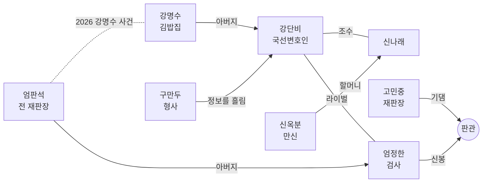

# 「판 뒤집기」 시리즈 설계

시리즈 1기(1~4화)의 세계관, 인물, 에피소드 줄기를 정리한 문서다. 새 사건을 쓰거나 기존 대사를 고칠 때 이 문서와 어긋나지 않게 한다. 바꿔야 할 설정이 생기면 이 문서를 먼저 고친다.

- 그림 규칙은 [art-guide.md](art-guide.md), 실행·대본 문법은 [README](../README.md)를 본다.
- 1화와 4화는 플레이할 수 있다. 2~3화는 이 문서의 줄기만 있다.

---

## 1. 한 줄 소개

> AI가 유죄 확률을 계산해 주는 2031년 서울. 사흘 안에 끝나는 재판에서, 신참 국선변호인 강단비가 숫자에 맞서 사람의 말로 판을 뒤집는다.

**시리즈의 질문:** 기계가 판단하는 세상에서, 사람의 말은 무엇을 뒤집을 수 있는가.

**제목:** 「판 뒤집기」. 재판(判)의 '판'과 판을 뒤집는다는 '역전'을 겹친 말이다. 씨름의 기술 이름이기도 하다.

---

## 2. 세계관

### 2.1 2031년 서울

AI가 일상의 많은 결정을 대신하는 근미래다. 기술 수준은 "지금 뉴스에 나오는 것들이 흔해진 정도"로 잡는다. 하늘을 나는 차나 로봇 경찰은 없다.

| 흔해진 것 | 예시 |
|---|---|
| 무인 매장 | 편의점·카페 대부분이 무인. 밤에는 진열·청소하는 관리원 한 명만 있다 |
| AI 상담원 | 콜센터의 대부분이 AI로 바뀌는 중 (4화) |
| AI 감정·평가 | 집값 자동 감정 앱, AI 신용 평가 (2화) |
| 생성형 AI | AI 강사, 목소리 복제, 딥페이크 (3화) |
| 스마트 기기 | 스마트 글라스(엄정한), 홀로그램 패널이 박힌 법정 벽 |

사람들의 정서는 두 갈래다. 일자리를 잃을지 모른다는 **불안**, 귀찮고 힘든 일을 덜어 줄 거라는 **기대**. 시리즈는 어느 한쪽 편을 들지 않는다. 기계 자체보다 **기계를 핑계 삼거나 기계 뒤에 숨는 사람**이 문제라는 쪽으로 이야기를 맺는다.

### 2.2 판관(判官): AI 판결 예측 시스템

법원행정처가 도입한 AI. 증거와 기록, 과거 판례를 학습해 사건마다 **유죄 확률**을 계산한다.

- 법정 화면에 예측률이 실시간으로 뜬다. 게임의 **체력 게이지**가 바로 이것이다.
- 법적으로는 "참고 자료"일 뿐이지만, 판사들은 점점 이 숫자에 기댄다. 100%에 가까우면 사실상 유죄가 선고된다.
- 판관은 **기록**을 사람의 **말**보다 무겁게 친다. 사원증 기록, 카메라 판정, 소득 데이터 같은 것들. 그래서 증언대에 선 사람이 가족이거나 가난하면 예측률이 오른다. 시리즈가 조금씩 드러내는 판관의 편향이다.
- 게임 안 표기는 "판관 · AI 판결 예측"이다. 인물들이 부를 때는 "판관"이라고 한다.
- 매장의 감시 AI(1화 "아이가드")와 헷갈리지 않게 한다. 아이가드는 카메라에 찍힌 행동에 **이름을 붙이고**(분류·확신도), 판관은 법정에 제출된 기록으로 **유죄 가능성을 예측하고**, 판결은 **사람(재판장)**이 내린다. 1화 개정 첫머리의 법정 화면이 이 셋을 나란히 보여 준다.

### 2.3 즉결공판제

재판 적체를 해결하려고 2028년에 시행된 제도. **기소 뒤 사흘 안에 첫 공판을 열고, 공판은 사흘 안에 끝낸다.** 판관이 증거 분석을 대신해 준다는 이유로 가능해졌다.

- 결과를 기다려야 하는 확인(감정 등)이 남아 있으면, 그 사흘 안에서 기다린다. 확인되지 않은 것을 건너뛰고 선고하지는 않는다(1화 재판장, 오후 4시 감정).

- 1일째 모두진술·증거조사, 2일째 증인신문, 3일째 판결이 기본 흐름이다. 실제로는 중간에 결정적인 증언이 나오면 일정이 당겨진다.
- 변호인이 조사할 수 있는 시간은 재판 전날과 재판 사이의 밤뿐이다. 게임의 "조사 파트"가 짧고 긴박한 이유다.
- 국선변호인 한 명이 너무 많은 사건을 맡는다. 강단비가 늘 시간에 쫓기는 배경이다.

### 2.4 연표

| 연도 | 일 |
|---|---|
| 2025 | 판관 시범 도입. 예측률은 판사만 참고용으로 본다 |
| 2026 | **강명수 사건.** 판관 예측 91%. 국선변호인의 권유로 강명수가 유죄를 인정한다 |
| 2027 | 블랙박스 영상이 나와 강명수가 재심에서 무죄. 당시 재판장 엄판석이 사퇴한다 |
| 2028 | 즉결공판제 시행. 판관 예측률을 법정 화면에 띄우는 것이 의무가 된다 |
| 2030 | 강단비, 변호사시험 합격 후 국선전담변호사가 된다 |
| 2031년 3월 | 1화 (구현됨) |
| 2031년 6월 | 2화 |
| 2031년 8월 | 3화 |
| 2031년 10월 | 4화 (구현됨) |

### 2.5 무대

| 장소 | 설명 |
|---|---|
| 서울 즉결법원 제417호 법정 | 대부분의 재판이 열리는 곳. 호두나무 벽, 벽에 박힌 홀로그램 패널, 가상의 저울 문장 |
| 피고인 대기실 | 휴정과 판결 뒤 장면. 베이지색 벽, 긴 벤치, 정수기, 벽시계 |
| 국선 사무실 | 법원 별관 3층, 창문 없는 방. 서류 더미와 컵라면. 나래가 눌러앉는 곳 |
| 명수네 김밥 | 강단비 아버지의 김밥집. 시리즈의 쉼표 같은 장소 (3화 첫 등장 예정) |

---

## 3. 주제와 모티프

### 3.1 화마다 다른 AI의 얼굴

| 화 | AI·자동화의 얼굴 | 한국적 정서 | 한 줄 주제 |
|---|---|---|---|
| 1화 | 무인 매장의 감시 AI | 정(情) | 기계는 친절을 절도로 읽었다 |
| 2화 | AI 집값 감정 | 한(恨), 내 집 마련 | 숫자로 매겨진 집에, 사람이 산다 |
| 3화 | 목소리 복제·AI 강사 | 교육열, 체면 | 목소리를 빼앗긴 사람 |
| 4화 | AI 상담원 | 가족, 감정노동 | 사람을 대신한다던 AI 뒤에, 사람이 있었다 |

### 3.2 반복 모티프: 밥

"밥은 먹었니?"는 한국어에서 가장 흔한 안부이자, 기계가 흉내는 내도 대신할 수는 없는 정(情)의 말이다. 화마다 한 번씩 밥이 등장하고, 4화 에필로그와 시리즈 마지막 장면에서 모인다.

| 화 | 밥 장면 |
|---|---|
| 1화 | 신태오가 폐기 삼각김밥을 폐지 줍는 할머니에게 몰래 건넨다 |
| 2화 | 신당의 고수레 밥 한 공기. 철거 전날 밤 할머니가 동네에 돌린다 |
| 3화 | 학원 셔틀 안에서 재수생이 먹는 편의점 김밥. "명수네 김밥"과 이어진다 |
| 4화 | "식사는 하셨어요?" 박순자의 끝인사를 다온이 배운다 (구현됨) |
| 시리즈 끝 | 명수네 김밥에서 강명수가 엄정한에게 김밥을 내민다 |

### 3.3 이름 짓기

주요 인물 이름에는 성격이나 역할을 담은 말장난을 넣는다. 사건 관계자는 말장난 없이 자연스러운 이름도 괜찮다.

| 이름 | 뜻 |
|---|---|
| 강단비 | "강단 있는" + 단비 |
| 신나래 | 신(神) + 나래(날개). 신나는 아이 |
| 엄정한 | 엄정(嚴正)하다 |
| 고민중 | 늘 "고민 중" |
| 구만두 | "그만둬!" + 만두 |
| 판관 | 옛 재판관을 부르던 말 |

---

## 4. 주요 인물

### 강단비 (28) — 주인공, 국선전담변호사

- **겉모습:** 짧은 단발에 일자 앞머리, 짙은 남색 정장, 작은 금색 변호사 배지.
- **성격:** 겁이 많지만 물러서지 않는다. 생각이 많아서 속마음(파란 글씨)이 길다. 결정적인 순간엔 목소리가 커진다.
- **말투:** 기본은 해요체. 몰아붙일 땐 짧게 끊어 말한다. "이의 있음!"
- **동기:** 아버지 강명수가 판관 예측 91%에 눌려 하지 않은 일을 인정했다. 그때 국선변호인은 "숫자가 이렇게 나오면 인정하는 게 낫다"고 했다. 단비는 숫자 앞에서 포기하지 않는 국선변호인이 되겠다고 정했다.
- **비밀:** 아버지 사건을 맡았던 재판장이 엄정한의 아버지라는 걸 3화 전까지 모른다.
- **성장:** 1화(처음 맡은 살인 사건)에서는 예측률 숫자에 손이 떨린다. 4화에서는 "판결은 사람이 내린다"는 걸 법정에 증명한다.

### 신나래 (19) — 조수

- **겉모습:** 긴 머리를 한 갈래로 땋고 빨간 댕기. 색동 소매 후드티, 놋쇠 방울 열쇠고리.
- **성격:** 밝고 입이 빠르다. 눈치가 귀신같다. 본인은 "신기(神氣)"라고 우기지만, 작품은 그게 진짜인지 끝까지 밝히지 않는다.
- **말투:** 반말. 단비를 "언니"라고 부른다. 감정이 그대로 나온다.
- **동기:** 할머니 신옥분은 이름난 만신인데, AI 사주 앱 때문에 손님이 줄고 신당은 재개발로 헐릴 처지다. 나래가 기계를 싫어하는 건 미신 때문이 아니라 **식구의 밥줄** 때문이다.
- **성장:** 1화에서 사촌 오빠 사건으로 단비를 만나 사무실에 눌러앉는다. 4화에서 "기계한테 고맙다고 해도 되는 거야?"라고 묻는다 (구현됨).

### 엄정한 (32) — 검사, 라이벌

- **겉모습:** 넘긴 검은 머리, 무테 스마트 글라스(렌즈에 옅은 청록색 반사), 짙은 회색 쓰리피스 정장.
- **성격:** 냉정하고 오만하다. 판관의 숫자를 인용하는 게 버릇이다 ("유죄 확률 97.3%입니다").
- **말투:** 격식체. 비꼴 때 존댓말이 더 정중해진다.
- **동기:** 아버지 엄판석은 강명수 사건의 재판장이었다. 오판 끝에 사퇴한 아버지를 보며 "사람은 틀린다. 기계를 믿어야 한다"고 결심했다.
- **비밀:** 판관 개발 자문단에 참여했다. 판관의 편향을 누구보다 먼저 알아챌 수 있는 위치다.
- **성장:** 1화에서 처음 진다. 2화에서 판관의 소득 가중치에 의문을 품는다. 3화에서 단비와 같은 사건의 상처를 공유한다. 4화에서 "기계가 아니라, 제 눈으로" 진실을 확인하겠다고 한다 (구현됨).

### 고민중 (64) — 재판장

- **겉모습:** 대머리에 옆머리만 희끗, 동그란 안경, 검은 법복에 자주색 띠, 나무 의사봉.
- **성격:** 착하고 우유부단하다. 판관 도입 뒤로 숫자에 기대는 버릇이 생겼다. 엉뚱한 데서 감동한다 ("겸손한 기계로군요").
- **성장:** 4화 판결에서 "판결은 기계가 아니라, 이 법정이 내립니다"라고 말한다 (구현됨).

### 구만두 (43) — 형사

- **겉모습:** 덩치 큰 몸, 구겨진 베이지색 트렌치코트, 손에는 늘 만두.
- **성격:** 사람 좋고 입이 가볍다. 상사에게 "그만둬!" 소리를 달고 산다.
- **말투:** "~임다", "~슴다".
- **역할:** 수사 정보를 흘려 주는 창구이자 웃음 담당. 결정적인 순간에 증거를 들고 법정에 뛰어든다.

### 조연

| 이름 | 나이 | 역할 | 처음 나오는 화 |
|---|---|---|---|
| 강명수 | 58 | 단비의 아버지. 전 택시 기사, 지금은 "명수네 김밥" 사장 | 3화 |
| 엄판석 | 67 | 엄정한의 아버지. 강명수 사건의 재판장, 사퇴 후 은둔 | 3화 (이름만), 4화 보강 |
| 신옥분 | 78 | 나래의 할머니. 달빛마을 신당의 만신 | 2화 |
| 신태오 | 24 | 나래의 사촌 오빠. 무인 편의점 야간 관리원 | 1화 |
| 조말순 | 81 | 오롯24 뒷골목에서 폐지를 줍는 할머니. 태오에게 폐기 삼각김밥을 받아 왔다 | 1화 |

---

## 5. 시리즈 줄기

1기의 큰 줄기는 **"판관의 숫자" 대 "사람의 반대신문"**이다. 화가 지날수록 판관이 무엇을 못 보는지가 하나씩 드러난다.

| 화 | 판관이 놓친 것 | 단비 | 엄정한 | 나래 |
|---|---|---|---|---|
| 1화 | 친절 (반출을 절도로 판정) | 첫 승리. 숫자 앞에서 떤다 | 첫 패배 | 사무실에 눌러앉음 |
| 2화 | 가난 (소득 데이터 가중치) | 증언의 무게를 배운다 | 판관의 편향을 처음 의심 | 할머니와 신당, 기계를 싫어하는 이유 |
| 3화 | 목소리 (복제된 정체성) | 아버지 사건의 진실과 마주 | 같은 사건, 다른 상처 | 단비 곁을 지킨다 |
| 4화 | 사람 (AI 뒤에 숨은 사람) | "판을 뒤집는" 변호사가 된다 | "제 눈으로" | 기계에게 고맙다 |

시리즈 결말: 4화 뒤 대법원이 판관 예측률의 법정 표시를 중단하기로 한다. 판관은 없어지지 않는다. 다만 숫자가 판결을 대신하지 못하게 된다.

---

## 6. 에피소드

모든 사건은 같은 순서로 설계한다. 진실의 타임라인을 분 단위로 먼저 쓰고, 범인이 지어낸 거짓말을 쓰고, 둘이 어긋나는 지점(모순)마다 그걸 증명할 증거를 하나씩 정한다. 증거는 미리 손에 쥐여 주고, 의미는 나중에 깨닫게 한다.

### 1화 「무인(無人)의 밤」 — 튜토리얼 (구현됨, 개정 EP1-R4)

- **분량:** 50~60분. 조사 파트 없이 법정 하루(오전, 점심 휴정, 오후, 오후 4시 재개정). 프롤로그, 비공개 면담, 반대신문 여섯 개. 논리 설계·정답 처리표·스펙 ID 대응은 `docs/ep1-rewrite.md`.
- **처음 하는 사람을 위한 구조(R4):** 프롤로그 다음 국선 사무실 장면에서 강단비가 누구인지(국선전담변호사, 첫 살인 사건, 아버지 사건과 판관 91%) 먼저 보여 준다. 접견실은 사람(태오, 나래, 봉지 이야기)만 다루고 증거를 몰아 주지 않는다. 기록은 개정 뒤 검사가 법정 화면에 하나씩 띄우며 넘긴다(인물 카드 → 평면도 → CAM1·CAM3 → 상처 도식 → 112 통화 → 현장 공유 사진 → 가방 속 상패 → 사실은 실선, 검찰 주장은 빨간 점선). 시스템은 처음 쓰일 때 안내 카드로 알려 준다(법원기록, 판관 예측, 반대신문, 지금의 쟁점과 수첩, 재검토 기회). 재판은 세 공방으로 나뉜다. ① 그날 밤, 창고에 있던 사람은 정말 태오뿐이었나 ② 태오가 들고 나간 봉지에는 무엇이 들어 있었나 ③ 머리 치명상은 언제 생겼고, 그때 태오는 어디 있었나.
- **무대:** 2031년 3월, 마포구 골목의 무인 편의점 "오롯24". 프랜차이즈 본사는 "오롯리테일".
- **사건:** 3월 15일 새벽, 점주 방대식(57)이 창고 안쪽 구석 책상 옆에서 머리를 다쳐 숨진 채 발견된다. 사망 추정 02:30~03:20. 확인된 머리 손상은 정수리 왼쪽 한 곳이고, 그 속에서 투명한 수지 조각 세 점이 나왔다(대조 감정 결과는 17일 16:00).
- **검찰의 주장:** 아이가드가 태오를 02:05~02:50 매장에서 찍었고, 02:55 112 신고가 "직원이 때리고 달아났다, 머리를 다쳤다, 의식이 없다"고 했으니, 범행은 태오가 창고에 있던 02:50~02:52의 2분.
- **피고인:** 신태오(24). 나래의 사촌 오빠, 야간 관리원. 감시 AI "아이가드"가 02:52 그를 **"상품 무단 반출"**로 표시했다. 판관 예측 96.4%.
- **진범:** 본사 슈퍼바이저 오정택(41). 점주가 반년 동안 녹음한 갑질 파일을 빼앗으러 왔다가 02:41 점주를 밀쳤다(손목·갈비뼈, 머리는 무사). 아이가드 판정 알림을 보고 02:55 112에 "직원이 때렸다, 머리를 다쳤다"는 설명을 먼저 남겼다. 상담원 안내로 전화기를 책상에 고정하고 현장 공유를 켠 뒤, 점주가 "전화… 이리 줘… 내가 말할 거야" 하자 02:55:56 책상 위 "상생 우수가맹점" 상패로 내리쳤다. 깨진 판 본체를 업무 가방에 넣고 뒷문으로 나가다 큰길에서 출동 중인 순찰 경찰에게 가방째 보존됐다. 3월 1일 "비용 절감"을 핑계로 뒷문 카메라를 직접 철거했다. 법정엔 "태오를 봤다"는 목격자이자 구조한 신고자로 선다. 말끝마다 "팩트만 말씀드리면", 손목엔 말하는 스마트워치.
- **"무단 반출"의 정체:** 태오는 밤마다 유통기한이 지난 음식을 뒷골목의 조말순 할머니에게 건넸다. 점주 방대식이 삼 년 전에 시작한 일이다. 실랑이 중 점주는 녹음기를 뒷문 옆의 빈 폐기 봉지 속으로 던져 숨겼고, 태오는 그걸 모른 채 봉지째 할머니에게 건넸다. 녹음기는 수레 위에서 골목의 대화까지 녹음했다. **기계가 절도로 읽은 친절이, 진실을 가게 밖으로 들고 나간 셈이다.** 점주가 그때 태오를 부르지 않은 이유는 끝까지 단정하지 않는다.
- **핵심 반전:** 플레이어는 녹음 속 02:41의 "쿵"을 사망 순간으로 읽는다. 오정택은 첫 폭행을 인정하고 "그 뒤엔 직원이 들어왔다"며 태오의 2분으로 의심을 되돌린다. 같은 기록을 다시 읽어 112 신고 앞부분이 "사건의 설명을 먼저 남긴 기록"이었음을 밝힌다.
- **마지막 입증은 독립된 세 자료로 한다(R2).** 오정택의 진술은 고리로 쓰지 않는다.
  1. 무엇: 16:00 감정. 상처 속 세 조각은 가방 속 판 왼쪽 아래 결손부의 파단면과 맞물리고, 골절 틈에 압입되어 있다.
  2. 언제: 112 현장 공유 사진. 02:55:48엔 그 외곽이 이어져 있고 02:55:58엔 없다. 사진은 타격 순간이 아니라 판의 상태만 보여 준다.
  3. 누가 없었나: 그 10초 동안 태오는 골목에서 할머니와 대화 중(녹음기), 뒷문은 바깥에서 열리지 않았다(도어락).

**진상 타임라인** (`src/content/ep1/records.ts` 맨 위에 초 단위로 있다)

| 시각 | 일 |
|---|---|
| 03/01 · 03/03 | 본사가 뒷문 카메라(CAM4) 철거. 점주가 뒷문 도어락을 안쪽 손잡이 열림까지 남는 기종으로 바꾸고, 청소 시간(02:00~04:00)엔 셔터를 내리기로 한다(점주 방침. 본사 표준은 밤새 유리창 조명이고, 아직 보고하지 않았다) |
| 02:00 | 셔터가 내려간다. 태오는 02:02 빈 폐기 봉지를 뒷문 옆에 두고, 02:05~02:50 매장에서 진열 (CAM1) |
| 02:25 · 02:33 | 방대식이 비밀번호로, 이어서 오정택이 방대식이 안에서 열어 준 뒷문으로 들어온다. 오정택의 시계가 가맹점 와이파이에 붙는다 |
| 02:36 · 02:40 | 녹음 시작. 방대식이 "못 줘!" 하며 녹음기를 폐기 봉지 속으로 던진다 |
| 02:41 | 첫 폭행. 손목을 움켜쥐고 밀친다. 운반대 모서리에 옆구리(갈비뼈 골절). 머리와 상패는 무사. 시계 "심박수가 높습니다"(02:41:09) |
| 02:50~02:52 | 발소리에 오정택이 방대식의 어깨를 누르며 "쉿"(녹음에 멀리 남는다). 태오가 봉지에 폐기 음식을 담아(녹음기가 섞인 채) 뒷문으로 나간다. 아이가드 "무단 반출", 알림이 오정택에게도 간다 |
| 02:53~03:01 | 골목 끝 가로등 밑(뒷문에서 약 50m)에서 태오와 할머니가 박스를 묶으며 이야기한다. 녹음기가 계속 녹음한다 |
| 02:55:00~16 | 오정택의 112 신고. "직원이 때리고 달아났습니다", "머리를 다치셨어요, 의식이 없습니다" |
| 02:55:37 | 상담원 안내로 전화기를 책상에 고정, 현장 공유 시작(10초 간격 사진) |
| 02:55:44~56 | 방대식 "전화… 이리 줘…", "내가… 말할 거야… 손 놔—". 오정택은 "제가 설명하겠습니다", "잠깐. 전화는… 놔요."로 설명을 지키려다 통제를 잃는다. 02:55:56 상패로 내리친다. 02:55:59 시계 두 번째 경고 |
| 02:57 | 판 본체를 서류로 감싸 가방에 넣고 안쪽 손잡이로 뒷문을 나간다(02:57:10). 할머니가 양복 남자를 본다. 02:58 큰길에서 순찰 경찰이 가방 혈흔을 보고 보존 |
| 03:02 · 03:20 | 사이렌을 들은 태오가 경찰·구급대와 함께 비밀번호로 들어간다. 03:20 가방 개봉, 판 본체 봉인, 같은 날 조각 대조 감정 의뢰 |
| 3/17 16:00 | 감정 결과 도착 |

**법정 흐름과 모순**

| 순서 | 증언·장면 | 모순·쟁점 | 증거 |
|---|---|---|---|
| - | 피고인 접견실 비공개 면담 | 봉지의 정체를 태오에게서 듣고 할머니 출석을 부탁한다. 나래의 셔터 사진이 첫 증거. 수사 기록은 법정에서 받는다 | 선택지 |
| - | 개정, 검찰 모두진술 | 법정 화면으로 아이가드·판관·재판장의 역할. 검사가 기록을 하나씩 띄워 넘긴다(가방 속 상패 판과 오후 4시 감정 대기 포함). 사실은 실선, 주장은 빨간 점선 | 안내 카드 |
| 1 | 구만두 「사건 개요」 (튜토리얼, 차감 없음) | "셔터 뒤 CAM1에 한 명뿐" ↔ 그건 매장 구역의 관측. 평면도에서 카메라 밖의 발견 위치를 찍는다 | 평면도, 현장 사진, 아이가드 |
| 2 | 오정택 「제가 본 것」 (튜토리얼) | 본사 표준(밤새 유리창 조명)을 믿고 보탠 "앞 유리창 너머로 봤다" ↔ 이 가게는 3월 3일부터 점주 방침으로 셔터를 내렸다. 엄정한: "경찰 진술은 '다툼을 알아챘다'" | 셔터 안내문 사진, 아이가드 |
| 3 | 오정택 「골목에서 들은 소리」 | "02:45 창고에서 젊은 남자가 다퉜다" ↔ 그 시각 태오는 CAM1에. 엄정한: "02:45는 증인이 오늘 처음 붙인 시각, 검찰 시간표는 CAM3 진입과 112 신고" | 아이가드 감지 기록 |
| - | 조말순 할머니 | 봉지 속은 점주가 허락한 폐기 음식. 내려놓을 때 딱딱한 소리, "유난히 묵직" → 플레이어가 증거대의 봉지를 직접 살펴(한 화면 조사) 바닥에서 녹음기 | 폐기 음식 봉지, 선택지, 조사 |
| - | 녹음기 재생 (가짜 승리) | 02:41 "쿵"은 태오 입실 9분 전. 첫 충돌에 태오는 없었다 | 선택지 |
| 4 | 오정택 「녹음 속 사람」 | "그게 저였다는 건 다르다" ↔ 녹음 속 기계음 = 증인의 시계 → 시계 기록 제출 | 녹음기 또는 인물 오정택 |
| - | 시계 대조 | 02:41:09 같은 초의 경고 → 첫 폭행 인정. "어디까지 입증했나"에서 과잉 결론은 엄정한이 바로잡는다 | 선택지 |
| 5 | 오정택 「남은 시간」 | "02:45쯤 뒷문으로 나갔다" ↔ 도어락 02:33~02:52 열림 없음 | 뒷문 도어락 기록 |
| - | 통화 중 피고인은 | 엄정한: "피고인이 다시 들어왔을 가능성" ↔ 플레이어가 112 통화의 남성 B와 가장 가까운 골목 녹음의 말을 짝짓는다. 녹음기 시계는 철문 소리 두 번으로 도어락과 대조, 통화 종료까지 뒷문 열림 없음 | 녹음기, 도어락, 짝짓기 |
| 6 | 오정택 「상패와 머리 손상」 | "머리 상처와 상패는 별개" ↔ 그건 확인된 사실이 아니라 대조 감정 대기. 무엇과 무엇을 대조할지 고른다. 현장 공유 사진을 먼저 내면 10초 구간을 미리 확인 | 부검, 수거물 기록, 현장 공유 사진 |
| - | 오후 4시 감정 결과 | 무엇(감정서의 파단면 문장을 고른다) → 언제(사진에서 판 왼쪽 아래 모서리를 지목하고, 모서리가 남은 마지막 사진과 사라진 첫 사진을 고른다. 그 10초의 골목 녹음을 다시 들으며 알리바이를 회수) → 마지막 확인(신고자의 말과 확인된 기록을 짝지어, 02:55:16 "머리를 다치셨어요"가 02:55:48 사진보다 앞섰음을 플레이어가 찾는다) | 증거 셋 + 선택지 + 사진 단계 + 짝짓기 |

- **연출:** 감시 카메라 화면, 스마트워치 CG, 골목 CG, 녹음기·112 재생 화면, 두 녹음 짝짓기 화면, 112 현장 공유 사진(같은 배경 그림 위에 상패를 얹은 7장, 두 장 비교와 전체 보기, 감정 뒤 확대·도식), 증인 이름판, 에피소드 타이틀, 평면도, 기록과 주장을 글자 표지로 나눈 보드, 법원기록 덧붙임(원문은 그대로).
- **판관 예측:** 서사가 정한 값으로만 움직이고, 머리 타격 혐의가 끊기기 전까지는(48.0 → 42.0) 크게 내려가지 않는다. 숫자가 아니라 미해결 쟁점이 긴장을 만든다. HUD엔 "지금의 쟁점" 한 줄. 바뀔 때 이유를 잠시 보여 준다. 숫자 아래 배지(신고 내용 미검증 / 진술 검토 중 / 감정 대기 / 확인된 기록 / 판결 확정). 오답은 숫자 대신 **재검토 기회 3칸**을 줄이고, 0이 되어도 유죄로 가지 않는다.
- **음악:** 휴정은 대기실 곡, 후반 두 반대신문은 같은 동기의 긴장 변주, 16:00 감정은 진상 직전의 곡, 10초 구간 결론부터 마지막 확인까지는 타이틀 동기를 펼친 추궁, 정답 순간 무음과 이의 있음.
- **힌트:** 요청할 때만(H). 지금의 쟁점 → 살펴볼 자료 → 구체적으로, 한 단계씩.
- **맞는 지적은 인정한다:** 맞는 근거를 일찍 내밀면 차감 없이 인정하고 수첩에 [확인]·[남은 질문]·[주의]로 남긴 뒤 아직 빠진 것을 가리킨다.
- **인물 비트:** 단비의 첫 살인 사건, 그리고 첫 오독("맞는 녹음을 원하는 데까지 읽었다"). 신중한 결론을 고른 플레이어는 그 장면을 건너뛴다. 나래는 휴정 때 "언니"라고 부르기 시작하고, 점심 휴정에 "확실한 것부터 다시 적자"며 펜을 꽉 쥔 단비의 손을 펴게 한다. 나래는 논증을 다시 말해 주지 않는다. 초반엔 조작을 묻고, 중반엔 사람을 관찰하고(오정택이 손목을 만진다, 태오 쪽을 안 본다), 막히면 힌트 창이 맡는다. 오정택은 확인될 만한 일(출입, 신고)은 인정하고 보이지 않은 구간의 인과를 꾸미는 사람이라, 그의 거짓은 본사 표준처럼 "그가 아는 세계"에서 나온다. 엄정한은 시계 제출을 요구하고, 남은 가능성(통화 중 피고인이 다시 들어왔나)을 스스로 닫고, 끝에 "기록을 믿는 것과 기록 안의 설명을 믿는 것"을 구분하지 않았다고 인정한다. 고민중은 "판관도 같은 생각이라니 안심했다"고 해서 4화의 성장을 남겨 둔다.
- **밥:** 감정을 기다리는 동안 나래가 "밥은?" 묻고, 끝에 할머니가 단비에게 오늘 아침 산 삼각김밥을 쥐여 주며 "밥은 먹었어?"

### 2화 「재개발의 한(恨)」

- **분량:** 60~80분. 조사 1일 + 법정 2일.
- **무대:** 2031년 6월, 재개발을 앞둔 빌라촌 "달빛마을". 나래 할머니의 신당이 있는 동네.
- **사건:** 빌라 "행복하우스"의 건물주 최봉구(61)가 옥상에서 떨어져 숨진다.
- **피고인:** 한소윤(31). 전세 보증금 2억 3천만 원을 날린 세입자이자 전세 피해자 모임 대표. 사건 전날 SNS에 "죽여 버리고 싶다"고 썼고, 옥상에서 다투는 모습이 목격됐다. 판관은 부채 비율과 소득 데이터로 "경제적 동기"에 가중치를 둬서 89%.
- **진상:** 공인중개사 안태수가 건물주와 짜고 AI 집값 감정 앱 "집값닷AI"의 데이터를 조작해, 깡통전세를 정상 매물처럼 보이게 했다. 건물주가 자수하려 하자 옥상에서 밀었다.
- **핵심 모순 후보:**
  1. 등기부등본의 근저당 설정 날짜와 감정 앱 시세 그래프의 어긋남.
  2. 옥상 디지털 도어락의 열림 기록.
  3. 실거래가 신고 내역과 앱이 보여 준 "시세"의 차이.
- **새 메카닉 후보:** 서류 두 장을 겹쳐 다른 곳 찾기 (등기부등본 대 감정서).
- **인물 비트:** 나래 할머니 신옥분 등장. 신당은 철거 위기이고 손님은 AI 사주 앱에 뺏겼다. 엄정한이 판관의 소득 가중치를 처음 의심한다.

### 3화 「목소리를 훔친 밤」

- **분량:** 70~90분.
- **무대:** 2031년 8월, 대치동 학원가. 수능을 석 달 앞둔 여름.
- **사건:** "AI 1타" 서비스 출시를 앞두고, 수학 1타 강사 정진석(45)이 원장실에서 숨진다.
- **피고인:** 윤가람(19, 재수생). "가람아, 원장실로 와"라는 정진석의 음성 메시지를 받고 갔다가 현장에서 잡혔다. 판관 93%.
- **진상:** 학원 원장 나상철이 정진석의 목소리를 학습한 AI 1타로 정진석을 밀어내려다 다툼이 났다. 그 뒤 복제한 목소리로 가람을 불러내 누명을 씌웠다.
- **핵심 모순:** 정진석은 부산 출신이라 화가 나면 사투리가 튀어나온다. 그런데 "화난 목소리"로 보낸 음성 메시지는 끝까지 표준어다. 그 메시지는 정진석이 보낸 게 아니다.
- **새 메카닉 후보:** 녹음 두 개를 나란히 들으며 다른 부분 고르기.
- **인물 비트 (시리즈의 중심 공개):** 단비의 아버지 강명수 사건이 밝혀진다. 그 사건의 재판장이 엄정한의 아버지 엄판석이었다는 것도. 한 사건에서 단비는 "숫자", 엄정한은 "사람"에게 상처받았다.
  - 엄정한: "사람은 틀립니다. 제 아버지처럼."
  - 단비: "기계는 틀려도 사과하지 않아요."

### 4화 「대체된 증인」 — 1기 마지막 화 (구현됨)

- **분량:** 약 40분. 조사 1일 + 법정 3일.
- **무대:** 2031년 10월, 판교 AI 스타트업 "누리랩".
- **사건:** 투자 시연회 전날 밤, 대표 한도윤(41)이 서버실에서 숨진다.
- **피고인:** 박순자(52). AI 상담원 "다온" 때문에 해고된 20년 차 콜센터 팀장.
- **진상:** 다온은 밤마다 사람이 몰래 대신 답하고 있었다. 그중 한 명이 박순자의 딸 하은이다. 기술이사 서지훈은 이 사실을 알고 시연회를 취소하려던 대표와 다투다 그를 밀쳤다. 다온의 자막 저장을 미리 끄고, 반납된 박순자의 사원증을 썼다.
- **이 화가 시리즈에서 매듭짓는 것:** 엄정한의 "제 눈으로", 고민중의 "판결은 이 법정이", 나래의 "기계에게 고맙다", 단비의 "판을 뒤집는 게 내 일".
- **진행:** 조사(로비·고객센터·서버실) → 2일째 다온 증언(질문 재구성) → 하은 증언 → 3일째 서지훈 신문(주차장 기록, 다온 설정 기록, 인물 제시) → 진범 붕괴 → 무죄 → 다온 검수팀 에필로그.

---

## 7. 현재 4화와 이 문서의 차이

4화는 이 문서보다 먼저 만들어졌다. 1~3화를 붙이기 전이나 4화를 보강할 때 아래를 맞춘다.

### 꼭 맞출 것

| 항목 | 지금 | 맞출 방향 |
|---|---|---|
| 엄정한 프로필 | ~~"즉결공판제 도입 이후 패소한 적이 없다"~~ | 고침: "진 재판은 단 세 번, 세 번 모두 상대가 강단비" |
| 판관 이름 | 게임 안에서 이름 없이 "판결 예측 시스템" | 대사에서 한두 번 "판관"이라고 부른다 |
| 나래와 단비의 관계 | 4화에서 처음부터 아는 사이 | 1화부터 이어진 관계라는 걸 말투로 드러낸다 (지금 상태로도 큰 문제는 없다) |

### 완결감을 위해 보강할 장면

| 장면 | 하는 일 |
|---|---|
| 프롤로그 "사건의 밤" | 하은 시점으로 10월 14일 밤 고객센터를 보여 준다. 헤드셋 너머 다툼 소리, 떨리는 손으로 친 "됬어요". 범인 얼굴은 보이지 않는다 |
| 구치소 접견 | 재판 전날, 박순자와 처음 만난다. "식사는 하셨어요?"가 그녀의 끝인사라는 걸 여기서 처음 듣는다 |
| 2~3일째 사이 조사 | 구만두가 갖다주던 주차장 기록을 플레이어가 직접 찾는다 (누리랩 지하 주차장, 경비실) |
| 서지훈 사전 복선 | 조사 때 서버실 앞에서 마주치거나, 다온 이야기에 과하게 날 서는 장면 하나 |
| 시리즈 에필로그 | 다온 검수팀 다음에 "명수네 김밥" 장면. 판관 예측률 표시 중단 뉴스, 엄정한이 찾아와 김밥을 먹는다 |

---

## 8. 게임 시스템 로드맵

| 메카닉 | 처음 나오는 화 | 상태 |
|---|---|---|
| 증언·흔들기·증거 제시·판관 게이지 | 1화 | 구현됨 |
| 감시 카메라 화면, 이벤트 CG, 녹음기 재생 | 1화 | 구현됨 |
| 평면도 보기·찍기, 단계별 힌트, 선택지 | 1화 | 구현됨 |
| 재검토 기회, 요청형 힌트, 사진 비교, 체크포인트 | 1화 (R2) | 구현됨 |
| 법정 화면(모두진술 카드), 평면도 동선, 상처 도식, 안내 카드, 공방 카드, 한 화면 조사 | 1화 (R4) | 구현됨 |
| 사건 기록부(에피소드 선택), 대사 기록, 설정 | 1화 | 구현됨 |
| 조사 (조사·이동·대화·제시) | 2화 | 구현됨 |
| 질문 재구성 (AI 증인) | 4화 | 구현됨 |
| 인물 제시 | 4화 | 구현됨 |
| 서류 겹쳐 보기 | 2화 | 계획 |
| 녹음 비교 | 3화 | 계획 |

---

## 9. 톤과 문장

- **웃음과 무게를 번갈아.** 무거운 장면 바로 앞뒤에 구만두나 나래의 한마디를 둔다. 다만 진범 붕괴와 모녀 장면에는 끼어들지 않는다.
- **흔들기는 캐릭터를 보는 보상이다.** 핵심 사실은 그대로 두고, 증인의 반응 → 짧은 받아치기 → 다시 사건으로. 웃음의 원천은 인물이다(구만두의 만두, 오정택의 기업 용어와 눈치 없는 스마트워치, 재판장이 말을 곧이곧대로 듣는 버릇, 나래의 생활어 번역, 조말순의 직설). 피해자, 조말순의 처지, 태오의 두려움은 웃음거리로 쓰지 않는다. 동료가 정답 증거를 먼저 말하지 않는다.
- **AI를 악당으로 만들지 않는다.** 범인은 언제나 기계를 핑계 삼거나 기계 뒤에 숨은 사람이다.
- **실제 기관·기업·인물 이름은 쓰지 않는다.** 서울, 판교, 대치동 같은 지명은 쓴다. 법원은 가상의 "서울 즉결법원"이다.
- **법은 그럴듯하게, 하지만 게임답게.** 즉결공판제와 판관은 허구의 제도다. 실제 형사소송 절차와 다른 부분은 설명하지 않고 넘어가도 된다.
- **증거 이름은 실제로 있을 법하게.** 등기부등본, 차량번호 인식 기록, 카톡 "1", 교통카드 환승 기록 같은 생활 속 기록이 한국적인 "아!"를 만든다.
